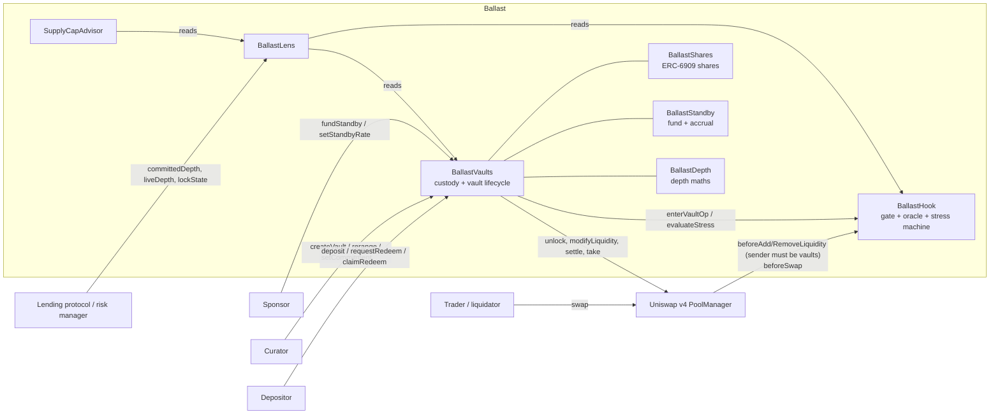

# Ballast

**Depth that can't leave when the liquidation arrives.**

Ballast is a Uniswap v4 hook that lets curators commit liquidity to the price band where liquidations will sell, locks that liquidity against withdrawal while the market is under stress, and publishes the committed depth on-chain so lending risk models can size collateral caps from depth that is actually guaranteed.

> **Status:** live on Unichain Sepolia with demo parameters and mock tokens. Unaudited. Not for mainnet or real funds. The crash comparison against a control pool has **not been run yet**, so this README makes no performance claims (see [Results](#results)). Read [SECURITY.md](SECURITY.md) before relying on anything here.

---

## The problem

Lending protocols decide how much of a collateral asset they will accept (the **supply cap**) largely from how much DEX liquidity exists to sell that collateral when a position is liquidated. The methodology discussed in Aave governance sets the cap at roughly **twice the liquidity available at the liquidation-penalty price impact**.

That liquidity is a snapshot, not a promise:

- Liquidity providers can withdraw at any moment, including the moment a crash begins, which is exactly when depth is needed.
- Much of it is attracted by incentives, and the same governance threads warn that it may fall once incentives end.
- Governance threads for assets such as LsETH, weETH (Plasma) and rsETH describe thin depth at the price impacts that matter for liquidations.

When liquidations meet thin depth, slippage rises, liquidations stop being profitable, and the protocol is left with bad debt. Issuers already pay to bootstrap liquidity (for example in the Mantle deployment discussion), but they are paying for TVL that is free to leave.

Sources (paraphrased, not quoted):
[USDe onboarding](https://governance.aave.com/t/arfc-onboard-usde-to-aave-v3-on-ethereum/17690) ·
[LsETH](https://governance.aave.com/t/arfc-onboard-lseth-to-aave-v3-core-instance/22957/3) ·
[weETH on Plasma](https://governance.aave.com/t/direct-to-aip-weeth-e-mode-risk-parameter-adjustment-on-aave-v3-plasma-instance/23381) ·
[rsETH](https://governance.aave.com/t/arfc-prime-instance-wsteth-borrow-rate-rseth-supply-cap-update/20644) ·
[Mantle](https://governance.aave.com/t/arfc-deploy-aave-v3-on-mantle/20542/14)

## Why it matters

A supply cap is only as good as the depth behind it. If the depth is uncommitted, the cap is an estimate of what *might* be there, and risk managers have to discount it heavily or accept tail risk. If depth is **committed, enforced by the pool itself, and readable on-chain**, a risk model can size a cap from a number it can trust, and an issuer can pay for depth that stays.

## The solution

Ballast turns "depth that exists right now" into "depth that is committed, enforced, and measurable".

1. **Only vaults can touch liquidity.** In a Ballast pool, nobody can add or remove liquidity except through one custody contract that the hook is bound to. The pool's entire depth is therefore committed depth.
2. **Curators manage, depositors follow.** Curators run vaults, choose price ranges and a committed depth target, and re-range actively. Depositors hold proportional, in-kind shares.
3. **Exits need notice, and freeze under stress.** Withdrawals go through a notice queue. When the pool's short-term price falls sharply against its own longer-term average, the queue freezes until the market calms or a hard maximum lock elapses.
4. **A sponsor pays for verified depth.** An issuer or risk DAO funds a per-second standby fee, paid only on conservatively sampled depth that meets the vault's commitment.
5. **Depth is published.** A read-only lens exposes committed depth, live depth net of upcoming exits, and the lock state, so lenders can read what is actually guaranteed.

The stress lock holds risk in place on purpose. It does **not** protect depositors from price losses; the standby fee is what they are paid for bearing that risk.

## What is new

Time-locked liquidity already exists, so the claim is narrower than "locked liquidity":

- **A stress gate.** The lock engages on a market condition (short TWAP deviating from the anchor TWAP in the liquidation direction), with hysteresis, a hard maximum duration and no re-arming until the market has been calm. Liquidity is free in calm markets and held in stressed ones.
- **Pool-wide committed depth.** Because all liquidity is hook-owned, the pool can report the depth of the whole pool, not of one position.
- **Lender-facing views.** `liveDepth(impactBps, horizon)` nets out exits maturing inside the consumer's horizon, so the number a lender reads already accounts for liquidity that is leaving.

Precedent and differences are discussed in [docs/ECONOMICS.md](docs/ECONOMICS.md).

## What was built

| Component | Role |
|---|---|
| `BallastHook` | The v4 hook (`BaseHook`). Enforces vault-only liquidity, writes the price oracle, runs the stress machine. Five permission flags only; no return-delta flags. Contains no `modifyLiquidity` or `unlock` path. |
| `BallastVaults` | Custody. Owns every position in the pool, runs vault lifecycle (create, seed, deposit, redeem, re-range, commitment changes), settles with the PoolManager through flash accounting. |
| `BallastShares` | ERC-6909 vault shares. |
| `BallastStandby` | Sponsor fund and standby-fee accrual. |
| `BallastDepth` | Stateless depth maths used by the vaults. |
| `BallastLens` | Read-only depth views for risk consumers (`IBallastDepthOracle`). |
| `SupplyCapAdvisor` | Reference view: converts live depth into a suggested supply cap. Illustrative; the multiplier is a consumer policy choice. |
| Libraries | `Observations` (ring-buffer tick-cumulative oracle), `BandMath`, `DepthMath`, `StressMachine` (pure state transition), `VaultMath`, `RewardMath`, and supporting helpers. |

There is no owner, admin, pauser or upgrade path. One hook serves exactly one pool and is bound to exactly one vaults contract at deployment.

**Uniswap v4 primitives used:** hook permission bits mined into the CREATE2 address, `beforeInitialize` pool binding, `afterInitialize` oracle seeding, `beforeAddLiquidity` / `beforeRemoveLiquidity` as the liquidity gate, `beforeSwap` for the oracle and stress evaluation, unlock-callback custody with flash accounting (re-range removes and re-adds in one unlock and settles only the net), PoolManager ERC-6909 claims for idle balances, and transient storage for the reentrancy guard and per-transaction flags.

## Architecture



Design notes:

- **Liquidity gate.** The PoolManager calls the hook's add/remove callbacks for any caller other than the hook itself. Custody therefore lives in a separate contract (`BallastVaults`), and the callbacks revert unless `sender == vaults`. The hook never calls `modifyLiquidity`, so it can never bypass its own gate; a bytecode test enforces this.
- **Share accounting has no oracle.** Shares are proportional claims on a vault's liquidity and idle balances, in kind. Deposits and redemptions never need a price.
- **Idle balances** are held as PoolManager claims, so idle movements stay inside flash accounting. Standby fees are paid in the quote currency straight into vault idle balances, shared pro rata, with no per-user reward debt.
- **Same-transaction guard.** A transaction cannot contain both a swap and a vault operation (transient-storage flags). This is defence in depth and can break zap-style integrations; the trade-off is recorded in [docs/DECISIONS.md](docs/DECISIONS.md).
- **Size.** `BallastVaults` is close to the EIP-170 limit (24,269 bytes runtime against 24,576), which is why read-only code lives in `BallastLens` and custody is split from the hook.

Full detail: [docs/ARCHITECTURE.md](docs/ARCHITECTURE.md), [docs/CONTRACTS.md](docs/CONTRACTS.md), [docs/storage-layout.md](docs/storage-layout.md).

## How a pool behaves

**Oracle.** `beforeSwap` maintains a running tick accumulator (exact, because price only changes at swaps) and a rate-limited ring buffer of snapshots. The anchor price is the TWAP over `anchorWindow`; the short price is the TWAP over `shortWindow`.

**Stress machine.** Liquidations sell collateral into the pool, so price moves in the *liquidation direction*. With `dev = A − S` measured in that direction:

```
        dev ≥ θ_enter                     dev < θ_exit for calmDuration
CALM ───────────────────▶ STRESS ───▶ RECOVERING ───────────────────────▶ CALM
                            ▲   dev < θ_exit │
                            └────────────────┘  (dev ≥ θ_enter again)
```

- The lock is active while the state is not CALM **and** `maxStressLock` has not elapsed since stress began. It cannot re-arm until the state has returned to CALM at least once, which bounds how long anyone can be trapped.
- Deposits are blocked in STRESS and RECOVERING. Re-ranging is CALM-only; during stress a curator can only add liquidity from idle balances (`deployIdle`), never reduce it.

**Bands and depth.** The band runs from the anchor price down (in the liquidation direction) by `bandBps`. *Committed depth* is the collateral a vault's ranges can absorb inside the band, rounded down. A vault must keep committed depth at or above its commitment in CALM; after `rerangeGrace` anyone can record a breach and the vault stops accruing standby fees until it restores coverage. Coverage is not enforced during stress, because liquidity being consumed by a falling market is the product working.

**Reading depth.** Lenders should size caps from `liveDepth(impactBps, horizon)`: collateral the pool can absorb from spot down the chosen impact, net of exits maturing within the horizon. `committedDepth()` is anchor-based and exists for coverage and reward accounting.

**Standby fee.** Accrual uses the minimum of the interval's start depth, end depth and the vault's commitment, capped per interval, so flash depth near a checkpoint earns nothing. Every share-changing action checkpoints first, which prevents reward sniping. If the fund runs dry, accrual stops; the lock still holds for any active stress episode and depth views decay honestly as exits mature. The guarantee is *depth plus notice*, not forever.

Normative detail: [docs/SPEC.md](docs/SPEC.md), [docs/MATH.md](docs/MATH.md).

## Guarantees

| ID | Guarantee |
|---|---|
| G-1 | **Vault-only liquidity.** Only the bound `BallastVaults` can add or remove liquidity. |
| G-2 | **Oracle-free proportional shares.** No NAV, price oracle or spot valuation in share accounting. |
| G-3 | **Stress lock.** No vault liquidity leaves while the pool is in stress, bounded by `maxStressLock`. |
| G-4 | **Exit notice.** Exits mature after `exitNotice`; reported depth is net of exits maturing inside the consumer's horizon. |
| G-5 | **Pay only for verified depth.** Standby fees accrue on conservatively sampled, coverage-compliant depth and stop when coverage breaks. |
| G-6 | **No privileged custody.** No role, function or parameter lets any address move or freeze depositor funds outside these rules. |

Each guarantee maps to named tests in [docs/COMPLIANCE.md](docs/COMPLIANCE.md).

## What Ballast does not do

- It does **not** protect depositors from price losses. The lock traps risk by design.
- It does not support native ETH pools, fee-on-transfer, rebasing or blocklist tokens.
- It has no upgrade path, owner, pauser or governance token.
- Sponsor funds are not withdrawable in v1; the sponsor stops spending by setting the rate to zero.
- It does not integrate with a real lending protocol; `SupplyCapAdvisor` is a reference view.
- It does not weight curators by their on-chain record; the record (covered seconds, breaches, re-ranges) is published, nothing more.

## Deployment

**Unichain Sepolia (chain 1301).** Demo configuration with compressed windows (1 h anchor, 5 min short window, 30 min maximum lock, 5 min exit notice), mock collateral and quote tokens with open `mint`. These are demo values, **not recommended production parameters**.

| Contract | Address |
|---|---|
| BallastHook | [`0x7ce8358E9b1071DCCa2D50faEC683aE3C7E4ba80`](https://sepolia.uniscan.xyz/address/0x7ce8358E9b1071DCCa2D50faEC683aE3C7E4ba80) |
| BallastVaults | [`0x650bDAb212B72A766714d55b9455cE8B3fb49ce6`](https://sepolia.uniscan.xyz/address/0x650bDAb212B72A766714d55b9455cE8B3fb49ce6) |
| BallastShares | [`0x2C408B7b01DB20f4c580e445c27f1FF23413232F`](https://sepolia.uniscan.xyz/address/0x2C408B7b01DB20f4c580e445c27f1FF23413232F) |
| BallastStandby | [`0xb766242bFffF121b3E4326A5Ff2078cc627D356F`](https://sepolia.uniscan.xyz/address/0xb766242bFffF121b3E4326A5Ff2078cc627D356F) |
| BallastDepth | [`0x581e669217b83B9190058FDf0eF930EB80CDf9f1`](https://sepolia.uniscan.xyz/address/0x581e669217b83B9190058FDf0eF930EB80CDf9f1) |
| BallastLens | [`0xb5262a5799aDB16868e07AbDA662aDCaADB8BEE5`](https://sepolia.uniscan.xyz/address/0xb5262a5799aDB16868e07AbDA662aDCaADB8BEE5) |
| SupplyCapAdvisor | [`0xe8e753710A8E016f94211cDBfA140E24e2635371`](https://sepolia.uniscan.xyz/address/0xe8e753710A8E016f94211cDBfA140E24e2635371) |
| Mock collateral (bCOL) | [`0x57c48bCa5ed9ce2001D488324a86BCD89a343063`](https://sepolia.uniscan.xyz/address/0x57c48bCa5ed9ce2001D488324a86BCD89a343063) |
| Mock quote (bQTE) | [`0xdC8E8dbFfd55577dF2AEB8E433C428fecFC2b220`](https://sepolia.uniscan.xyz/address/0xdC8E8dbFfd55577dF2AEB8E433C428fecFC2b220) |

Pool ID: `0x4474e61f3ae601150ab9eb3b9678ec436f86d9dcf540f3023b6292de8da0ef64` (fee 0.30%, tick spacing 60). All contracts are verified on Uniscan and Sourcify. Addresses are also in [`deployments/1301.json`](deployments/1301.json).

A deployment is valid only if `script/VerifyBinding.s.sol` passes against it; it passes for the deployment above. The deployment script mines the hook's CREATE2 salt for its five permission flags and asserts the address bits match `getHookPermissions()`. Details: [docs/DEPLOYMENT.md](docs/DEPLOYMENT.md).

## Testing and quality

The suite has unit, fuzz, differential, invariant, scenario, fork and gas layers:

- **Differential:** depth maths against brute-force swapping through a real PoolManager; the oracle against a naive reference; the stress machine against table-driven vectors.
- **Invariants:** handler-based suite covering custody, share supply, claims solvency, round-trip rounding, lock safety, reward caps and stress-machine legality (INV-1 to INV-15).
- **Scenarios:** crash through the band, coverage breach, sponsor drought, liquidation during stress, manipulation attempts and the exit race at crash onset.
- **Adversarial:** hostile-token reentrancy, self-call bypass, access-control enumeration of every external selector, and a mutation-testing log ([docs/MUTATION_LOG.md](docs/MUTATION_LOG.md)).

Last recorded figures from [docs/PROGRESS.md](docs/PROGRESS.md) (not re-measured for this README): 568 tests passing in the non-fork suite, 13 fork tests passing against Unichain Sepolia, 99.1% line and 96.8% branch coverage of `src/`, and Slither (CI flags) with no findings at low severity or above. One CI-profile invariant run (1024 runs at depth 256) did not finish locally and still needs a controlled rerun. See [docs/TESTING.md](docs/TESTING.md) and [docs/SLITHER_NOTES.md](docs/SLITHER_NOTES.md).

## Quickstart

```bash
git clone git@github.com:Maxwell316/Ballast.git && cd Ballast
forge install
forge build --sizes --skip "test/**" --skip "script/**"
forge test --no-match-path "test/fork/*"

# fork tests against Unichain Sepolia
RPC_URL=https://sepolia.unichain.org forge test --match-path "test/fork/*"
```

Requires Foundry, Solidity 0.8.26 and `evm_version = "cancun"` (transient storage). Deploying your own instance: [docs/DEPLOYMENT.md](docs/DEPLOYMENT.md).

## Results

The pre-registered crash comparison (Ballast pool versus an ordinary v4 pool with identical liquidity, a 12% fall and a liquidation-sized sell) is defined in [analysis/PREREGISTRATION.md](analysis/PREREGISTRATION.md), including its pass/fail bar. **It has not been run, and no results exist.** Nothing in this repository claims Ballast reduces slippage versus a plain pool. When the run is done, results will be published unchanged in [docs/SIMULATION.md](docs/SIMULATION.md), including any missed bar.

Whatever the numbers, they will depend on an assumed LP behaviour model (what happens *if* LPs flee), use one price path and mock assets, and cannot be extrapolated to mainnet.

## Known limitations

- Standard ERC-20 tokens only.
- A cold or sparse pool has no stress protection until the oracle is warm; sustained manipulation of a shallow pool can trigger or delay a lock.
- Depth is counted equally anywhere inside the band.
- Standby sampling is conservative at interval endpoints only.
- Holders with already-matured exit tickets can leave before the lock engages at crash onset (T18, quantified in the `ExitRace` scenario).
- Sponsor funds are not withdrawable in v1.
- `BallastVaults` has little bytecode headroom; further features would need the cuts recorded in the decision log.
- Demo parameters are compressed for a testnet that cannot warp time.

Full list: [SECURITY.md](SECURITY.md) and [docs/THREAT_MODEL.md](docs/THREAT_MODEL.md).

## Repository map

| Path | Contents |
|---|---|
| `src/` | Hook, vaults, shares, standby, depth calculator, libraries, interfaces, `periphery/` (lens, advisor) |
| `test/` | unit, fuzz, differential, invariant, scenario, fork, gas |
| `script/` | deployment (`DeployBallast`), binding check (`VerifyBinding`), own `HookMiner`, demo config, mocks |
| `docs/` | spec, contracts, architecture, math, threat model, testing, economics, deployment, simulation, decisions, verification |
| `analysis/` | simulation pre-registration and vectors |
| `deployments/` | deployed addresses per chain |
| `config/addresses.json` | official Uniswap and Unichain addresses with sources |

Suggested reading order: [docs/SPEC.md](docs/SPEC.md) → [docs/ARCHITECTURE.md](docs/ARCHITECTURE.md) → [docs/CONTRACTS.md](docs/CONTRACTS.md) → [docs/THREAT_MODEL.md](docs/THREAT_MODEL.md).

## License

MIT. See [LICENSE](LICENSE).
