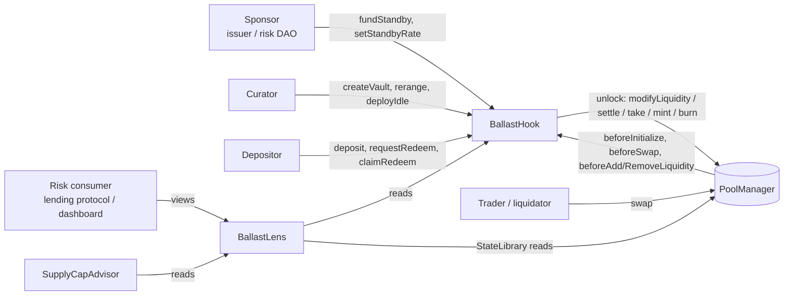
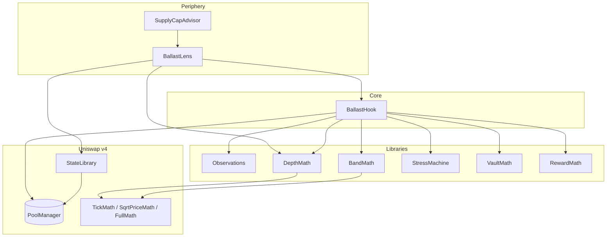
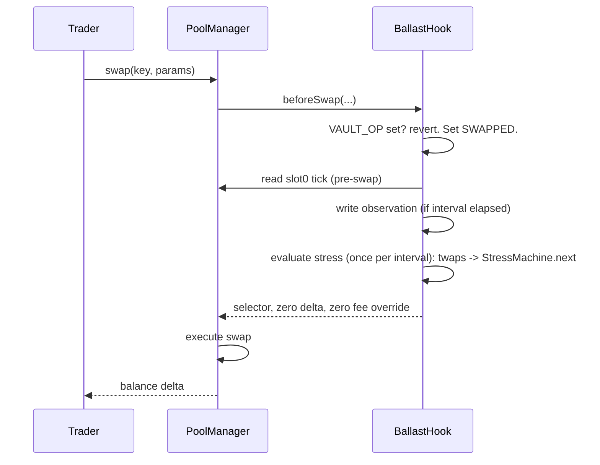
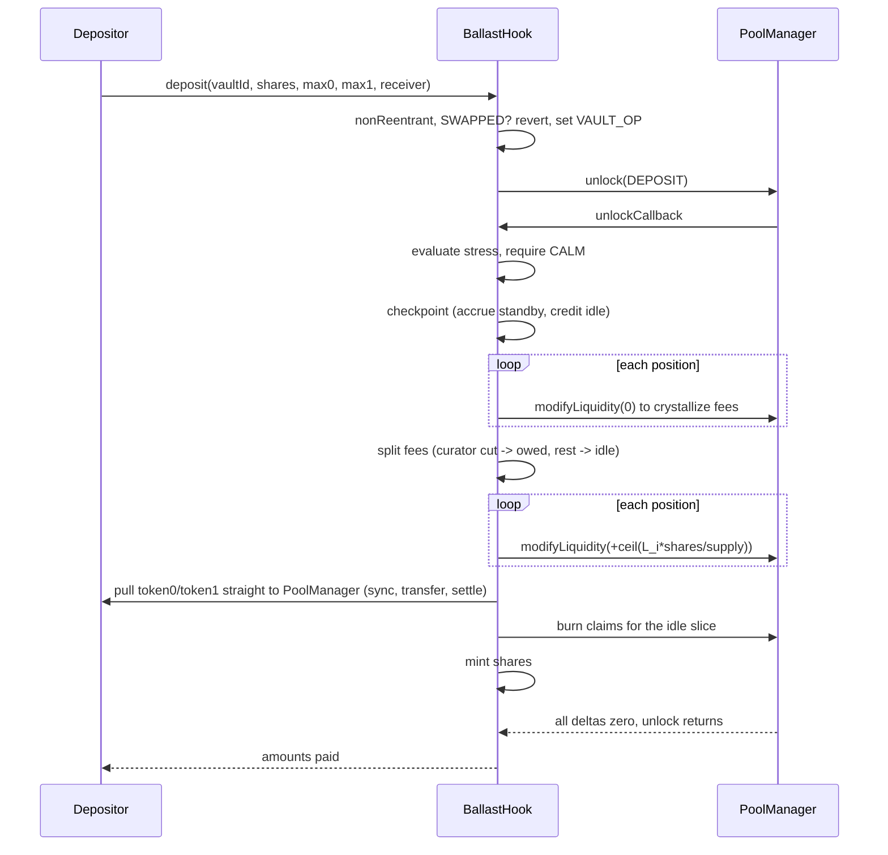
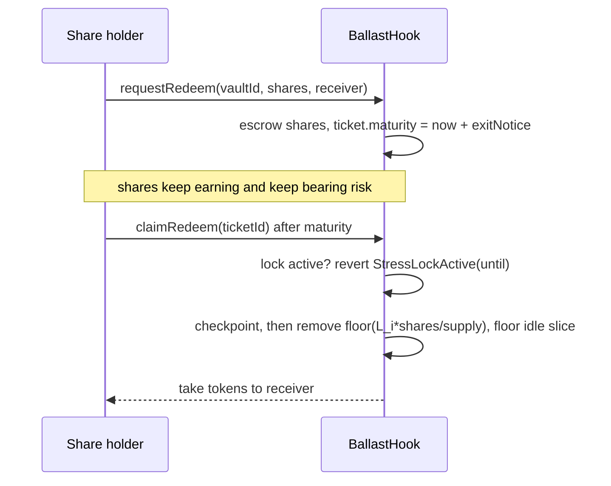
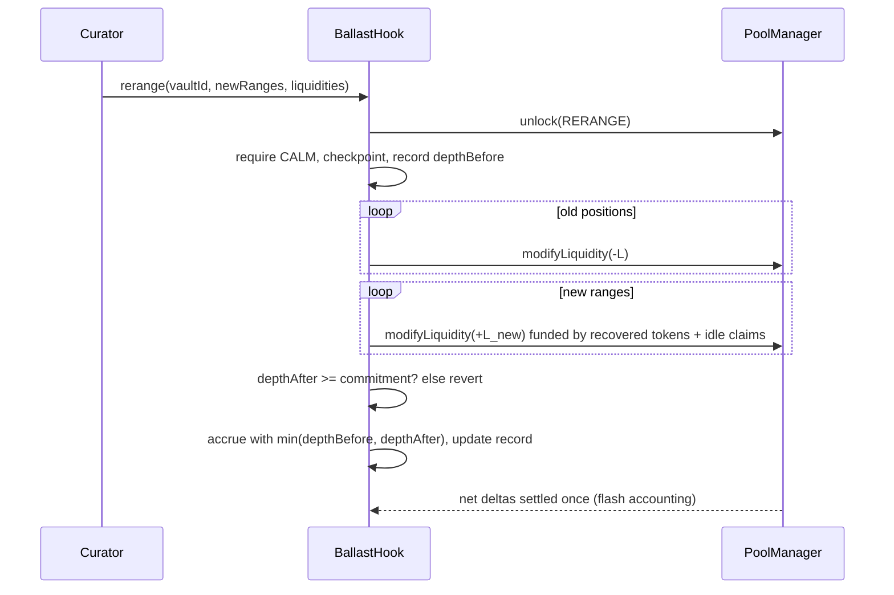
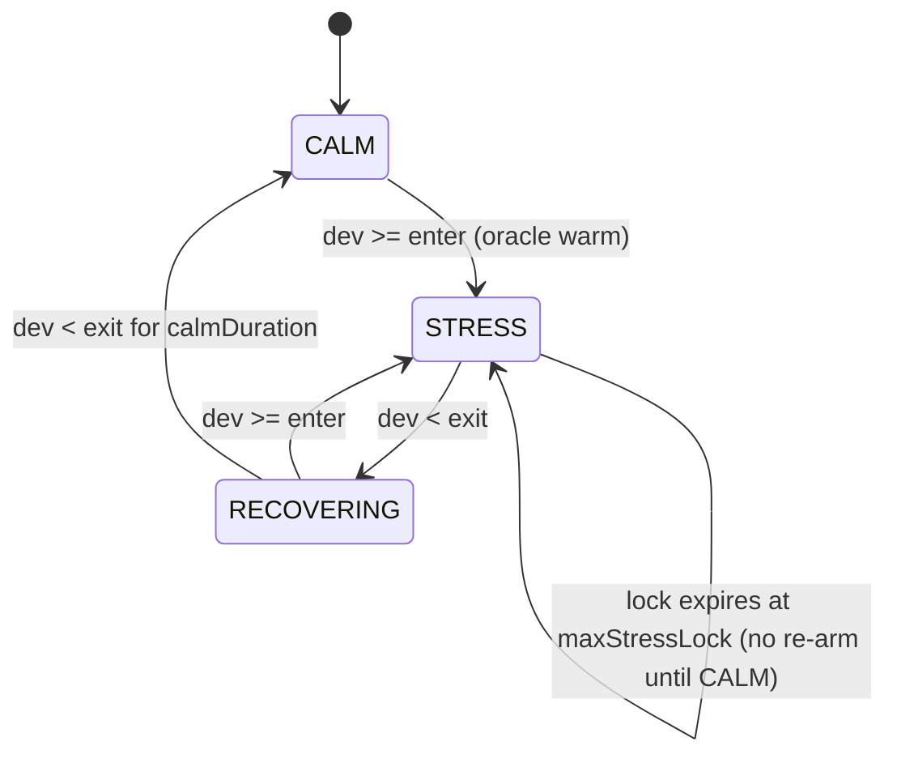
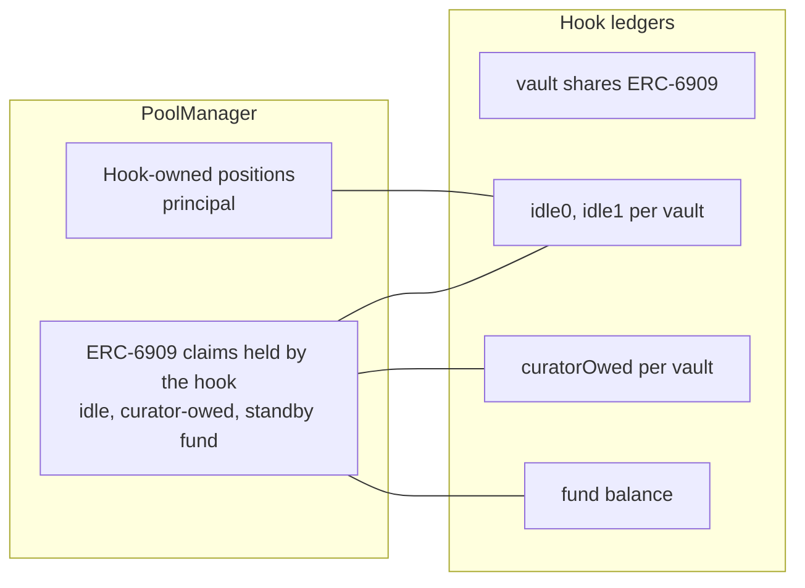

# Ballast Architecture

**Status:** Draft v0.1 · Companion to [SPEC](SPEC.md) and [CONTRACTS](CONTRACTS.md). Diagrams use Mermaid and render on GitHub.

---

## 1. Design goals

1. **Committed depth that a lender can read.** Every unit of liquidity in the pool is subject to the same exit rules.
2. **No privileged custody.** No owner, no pause, no upgrade. Funds move only by the rules in the spec.
3. **Oracle-free accounting.** Shares are proportional claims on liquidity and idle balances; no price enters minting or redeeming.
4. **Small trusted surface.** Pure maths in libraries, orchestration in one hook, read-only periphery elsewhere.
5. **Auditability.** Every state change emits an event, every invariant has a test, every formula has a derivation.

## 2. System context

## 3. Components

| Component | Responsibility | Trust notes |
|---|---|---|
| `BallastHook` | Holds all pool liquidity, enforces rules, accounts shares | The only contract that custodies funds. Security-critical. |
| `Observations` | Ring buffer of tick cumulatives | Pure storage-library logic |
| `BandMath`, `DepthMath` | Convert bps to ticks, compute absorbable collateral | Pure; differential-tested against real swaps |
| `StressMachine` | State transition function | Pure; table-driven reference test |
| `VaultMath`, `RewardMath` | Proportional share and reward arithmetic | Pure; rounding proven by fuzz |
| `BallastLens` | Aggregates depth for consumers | Read-only |
| `SupplyCapAdvisor` | Example cap suggestion | Read-only, informational |
| Scripts | Mining, deployment, demo | Never in `src/` |

## 4. Layering

Dependencies only point downward. Libraries never call the hook. The lens never writes state.

## 5. Key flows

### 5.1 Swap (`beforeSwap`)

`beforeSwap` never reads vault positions. Its cost is independent of the number of vaults.

### 5.2 Deposit

### 5.3 Redeem with notice and lock

### 5.4 Re-range (the curator's management action)

### 5.5 Stress lifecycle

Lock timeline: `stressStartedAt` is set when CALM → STRESS. The lock is active until `stressStartedAt + maxStressLock` or until the state returns to CALM, whichever comes first.

## 6. Custody model

- Principal lives in PoolManager positions owned by the hook.
- Idle balances, curator-owed amounts and the standby fund are PoolManager **claims** (`mint`/`burn`), so moving between them is accounting plus claim movement inside one unlock.
- Vault shares are the hook's own ERC-6909. They are unrelated to PoolManager claims. Code and docs distinguish them as `shares` and `claims`.
- No accounting reads token `balanceOf`. Unsolicited transfers to the hook are ignored and unrecoverable by design (documented in SECURITY).

## 7. Storage layout plan (to be finalized in M2/M3)

| Slot group | Content | Written by |
|---|---|---|
| Hot swap state | `lastObservationTs`, `lastTick`, `state`, `stressStartedAt`, `belowExitSince`, `rearmBlocked`, `oracleWarm` | `beforeSwap`, `pokeStress`, vault ops |
| Observations | Fixed-size array of `{timestamp, tickCumulative, initialized}` | `beforeSwap` |
| Vault records | `mapping(uint256 => Vault)`, packed into ≤ 4 slots | vault functions, checkpoints |
| Positions | `mapping(uint256 => Position[MAX_POSITIONS])` | vault functions |
| Tickets | `mapping(uint256 => RedeemTicket)`, `nextTicketId` | redeem functions |
| Curator records | `mapping(uint256 => CuratorRecord)` | checkpoints |
| Standby | `rate`, `fundBalance`, `totalCredited` | sponsor functions, checkpoints |
| Shares | ERC-6909 balances, allowances, operators, `totalSupply` | share ops |
| Immutables | `Config` fields, `poolManager`, `collateralIsCurrency0` | constructor |
| Transient | reentrancy flag, `SWAPPED`, `VAULT_OP` | all |

Use `forge inspect BallastHook storageLayout` to produce the authoritative table and commit it as `docs/storage-layout.md`.

## 8. Failure modes and responses

| Failure | Effect | Response |
|---|---|---|
| Oracle cold or sparse swaps | Stress stays CALM | `warm` flag exposed; documented limitation |
| Sponsor stops funding | Accrual stops | Views decay as exits mature; locks unaffected |
| Token with failing transfers | Payout reverts | Funds stay; receiver can change |
| Price shock inside one block | TWAP barely moves | By design: transitions need sustained deviation |
| Curator abandons vault | No re-ranging; coverage may breach | Standby stops; depositors can queue exits |
| Extreme volatility | Lock engages up to `maxStressLock` | Bounded trap; expiry releases exits |
| Gas griefing | Bounded loops | `MAX_VAULTS`, `MAX_POSITIONS` |

## 9. Rationale for key choices

- **Hook-owned liquidity** (D-2 with G-1): makes depth measurable for the entire pool and removes the "someone outside the rules can still pull" gap.
- **Proportional in-kind shares** (D-7): eliminates NAV and oracle dependence, the usual source of vault share manipulation.
- **Exit notice plus stress lock**: notice gives consumers a horizon-based guarantee; the lock covers the moments that matter most.
- **TWAP anchor and short window**: manipulation-resistant transitions with hysteresis.
- **Idle as PoolManager claims** (D-10): keeps balance movements inside flash accounting. Fallback to ERC-20 is acceptable if claim handling proves error-prone (ADR required).
- **Read-only lens**: keeps hook bytecode small and the audit surface focused.
- **No `BeforeSwapDelta`**: the hook does not alter swap pricing; adding it would increase attack surface without serving the goal.

## 10. External dependencies

v4-core (PoolManager, `StateLibrary`, `TickMath`, `SqrtPriceMath`, `FullMath`, `Hooks`), v4-periphery (`BaseHook`, `HookMiner`, optionally `LiquidityAmounts`), solady (math helpers, transient guard) and forge-std. Pin versions in `docs/DECISIONS.md`. No oracles, no keepers, no off-chain services.
